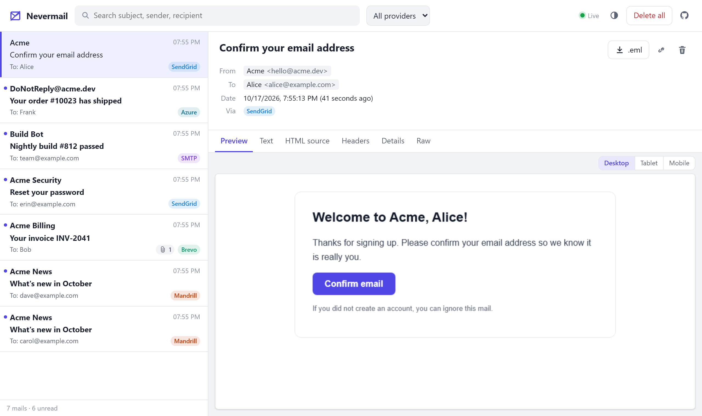

# Nevermail

*Your emails, never delivered.*

**A fake email provider for local development and tests.** Point your app at Nevermail instead of SendGrid, Brevo, Mailchimp Transactional, Azure Communication Services or an SMTP server. Your code sends mail exactly as it would in production; Nevermail accepts it, shows it in a web inbox, and never delivers anything.



```bash
docker run -d -p 5110:8080 -p 1025:1025 mdi1984/nevermail
```

Open [http://localhost:5110](http://localhost:5110) and send your first mail.

- **Drop-in APIs** for SendGrid, Brevo, Mailchimp Transactional (Mandrill), Azure Communication Services Email, and SMTP. Requests are validated like the real service, so what fails in production fails here too.
- **Web inbox** with live updates, search, HTML preview at desktop/tablet/mobile widths, headers, attachments and `.eml` download.
- **Built for tests**: an [inspection API](#inspection-api) that waits for a mail instead of sleeping, and [fault injection](#fault-injection) for rate limits, outages and bounces.
- **Tiny**: a ~16 MB NativeAOT image for `linux/amd64` and `linux/arm64`, with a [.NET Aspire integration](#net-aspire).

> Formerly **SendGrid Mock** (`mdi1984/sendgrid-mock`). That image is frozen; use `mdi1984/nevermail`.

## Connecting your app

Point your existing client at Nevermail. Any API key works unless you [configure one](#configuration).

| Provider | Point the client at | Auth |
|---|---|---|
| SendGrid | `http://localhost:5110` | `Authorization: Bearer <key>` |
| Brevo | `http://localhost:5110/v3` | `api-key: <key>` header |
| Mailchimp Transactional | `http://localhost:5110/api/1.3/` (any `1.x` works, with or without `.json` suffix) | `key` in the request body |
| Azure Communication Services | connection string `endpoint=http://localhost:5110/;accesskey=bmV2ZXJtYWls` | access key (any base64 value) |
| SMTP | `localhost:1025`, no TLS | optional |

```csharp
// SendGrid
var sendGrid = new SendGridClient(new SendGridClientOptions { ApiKey = "anything", Host = "http://localhost:5110" });

// Brevo (brevo_csharp)
var config = new brevo_csharp.Client.Configuration { BasePath = "http://localhost:5110/v3" };
config.ApiKey["api-key"] = "anything";
var brevo = new TransactionalEmailsApi(config);

// Mandrill.net uses the HttpClient's base address as API root
var mandrill = new MandrillApi("anything", new HttpClient { BaseAddress = new Uri("http://localhost:5110/api/1.3/") });

// Azure Communication Services (Azure.Communication.Email)
var azure = new EmailClient("endpoint=http://localhost:5110/;accesskey=bmV2ZXJtYWls");

// SMTP (MailKit, System.Net.Mail, ...)
await smtp.ConnectAsync("localhost", 1025, SecureSocketOptions.None);
```

Or with curl:

```bash
curl -i http://localhost:5110/v3/mail/send   -H 'Authorization: Bearer anything'   -H 'Content-Type: application/json'   -d '{
    "personalizations": [{ "to": [{ "email": "recipient@example.com" }] }],
    "from": { "email": "sender@example.com" },
    "subject": "Hello, World!",
    "content": [{ "type": "text/plain", "value": "This is a test!" }]
  }'
```

### .NET Aspire

```bash
dotnet add package Nevermail.Aspire.Hosting
```

```csharp
// App host
var mail = builder.AddNevermail("mail");

builder.AddProject<Projects.Api>("api")
    .WithReference(mail)   // ConnectionStrings__mail = Endpoint=...;SmtpHost=...;SmtpPort=...;AccessKey=...
    .WaitFor(mail);
```

```csharp
// Api project
var connectionString = builder.Configuration.GetConnectionString("mail")!;
var endpoint = (string)new DbConnectionStringBuilder { ConnectionString = connectionString }["Endpoint"];

builder.Services.AddSendGrid(o => { o.ApiKey = "dev"; o.Host = endpoint; });       // SendGrid
builder.Services.AddAzureClients(c => c.AddEmailClient(connectionString));          // Azure Communication Services
```

The dashboard links to the inbox. The [package README](Nevermail.Aspire.Hosting/README.md) has samples for every provider, options like `WithDataVolume()` and `WithFaults(...)`, using Nevermail locally and the real provider when deployed, and integration tests with `Aspire.Hosting.Testing`. The package works with any Aspire 13.x.

### Persistence

```bash
docker run -d -p 5110:8080 -p 1025:1025   -e Storage__Path=/app/data   -v nevermail_data:/app/data   mdi1984/nevermail
```

## Providers

### SendGrid

`POST /v3/mail/send`, plus `GET /v3/scopes`, `POST /v3/mail/batch` and `GET /v3/mail/batch/{id}`.

- All validation errors are reported at once in SendGrid's format: `{"errors":[{"message","field","help"}]}`.
- One mail per personalization, with that personalization's subject, headers, `from` and substitutions applied.
- Dynamic templates: `template_id` and `dynamic_template_data` are stored and shown. Templates themselves aren't rendered.
- `mail_settings.sandbox_mode` answers `200` like SendGrid. The mail is still captured, flagged as sandbox.
- The response's `X-Message-Id` is the `requestId` of the captured mails.

### Brevo (Sendinblue)

`POST /v3/smtp/email`.

- Errors look like Brevo's: `{"code":"missing_parameter","message":"..."}`, first error only.
- Checks the documented limits: name lengths, recipients per version and request, and the attachment extension allow-list.
- `messageVersions` become one mail each. Versions override the global subject, content, recipients and params.
- `{{ params.x }}` placeholders in subject and content are filled in. Filters, loops and template IDs aren't rendered.
- URL attachments are recorded but never downloaded.
- Returns `201` with `messageId` (or `messageIds` for versions), and `202` for `scheduledAt` in the future. Each message ID contains the captured mail's ID: `<mailId@nevermail.local>`.

### Mailchimp Transactional (Mandrill)

`messages/send`, `messages/send-template`, `users/ping` and `users/ping2` under `/api/{1.x}/`.

- Errors use HTTP 500 with `{"status":"error","code":-1,"name":"Invalid_Key",...}`, like Mandrill.
- Every recipient gets their own mail, unless `preserve_recipients` is set. Per-recipient `merge_vars` and `recipient_metadata` are applied.
- Merge tags: `*|NAME|*` (mailchimp) and `{{name}}` / `{{{name}}}` (handlebars, HTML-escaped in HTML content). Block helpers aren't rendered.
- Invalid recipients are reported as `"status":"invalid"` and aren't delivered, `send_at` in the future reports `"scheduled"`, and `images` become inline attachments.
- `send-template` accepts any template name and stores it with the template content and merge vars.

### Azure Communication Services Email

`POST /emails:send` and `GET /emails/operations/{id}`, for any `api-version` (`2023-03-31`, `2025-09-01`, previews and future versions).

- Sending starts a long-running operation like on Azure: `202` with an `Operation-Location` header. Nevermail completes it right away, so the SDK's `WaitUntil.Completed` returns after the first poll. The operation ID is the client's `Operation-Id` (the SDK always sends one) and the captured mail's `requestId`. Retries with the same `Operation-Id` don't send the mail twice.
- Errors look like Azure's: `{"error":{"code":"BadRequest","message":"Request body validation error. See property 'attachments[0].contentType'"}}` plus an `x-ms-error-code` header, first error only.
- Checks the documented limits: at most 50 recipients, 10 MB per request, and the attachment MIME type allow-list. The sender must be a bare address; whether its domain would be verified on Azure isn't checked.
- Requests must be signed with an access key (`HMAC-SHA256`) or carry a bearer token, but signatures aren't verified, so any base64 access key works. Microsoft Entra ID credentials (`DefaultAzureCredential`, managed identity) can't be used locally: the Azure SDK refuses bearer tokens over plain `http`. Use a connection string in development.
- Azure's SMTP relay (`smtp.azurecomm.net`) needs STARTTLS, which Nevermail doesn't support. Point SMTP clients at Nevermail's SMTP server without TLS instead.

### SMTP

Port `1025`. Supports `SIZE`, `8BITMIME`, `SMTPUTF8`, `PIPELINING` and `AUTH PLAIN`/`LOGIN`. STARTTLS isn't supported.

- Recipients in the envelope but not in the `To`/`Cc` headers show up as Bcc.
- The envelope (`MAIL FROM`, `RCPT TO`, `HELO`, user) is kept as metadata, and the raw message is kept too.
- Without `Smtp__Username`, any credentials (or none) are accepted.
- If the port is already taken (e.g. by Mailpit), Nevermail logs an error and keeps serving the HTTP APIs without SMTP.

## Configuration

| Variable | Description | Default |
|---|---|---|
| `Providers__SendGrid__ApiKey` | If set, requests must use this key. If unset, any key is accepted, but a missing `Authorization` header is always rejected, like SendGrid does. | unset |
| `Providers__Brevo__ApiKey` | Same for Brevo's `api-key` header. | unset |
| `Providers__Mandrill__ApiKey` | Same for Mandrill's `key` body field. | unset |
| `Providers__<Name>__Enabled` | Set to `false` to disable a provider's endpoints (`SendGrid`, `Brevo`, `Mandrill`, `Azure`). | `true` |
| `Smtp__Enabled` | Set to `false` to disable the SMTP server. | `true` |
| `Smtp__Port` | SMTP port inside the container. | `1025` |
| `Smtp__Username`, `Smtp__Password` | If set, clients must authenticate with these credentials before sending. | unset |
| `Smtp__MaxMessageSize` | Maximum message size in bytes. | `26214400` (25 MB) |
| `Smtp__IdleTimeoutSeconds` | Idle connections are closed after this time. | `300` |
| `Storage__Path` | Directory for mail files. If unset, mails are kept in memory only. | unset |
| `Storage__MaxMessages` | Oldest mails are dropped beyond this count. `0` = unlimited. | `1000` |
| `Faults__Rate` | Share of sends (0 to 1) that fail on purpose, see [Fault injection](#fault-injection). | `0` |
| `Faults__StatusCode` | HTTP status for those failures. SMTP answers `451`. | `503` |
| `Faults__DelayMs` | Delay added to every send, like a slow provider. | `0` |

## Inspection API

Useful for asserting on sent mails in integration tests.

| Endpoint | Description |
|---|---|
| `GET /api/mails` | Mail summaries, newest first. Query: `search`, `to`, `provider` (`sendgrid`, `brevo`, `mandrill`, `azure`, `smtp`), `requestId` (e.g. SendGrid's `X-Message-Id`), `limit`. Add `wait=<seconds>` (max 60) to block until at least `count` (default 1) mails match |
| `GET /api/mails/{id}` | Full mail including headers, attachments and the raw request |
| `GET /api/mails/{id}/attachments/{index}` | Download an attachment |
| `GET /api/mails/{id}/eml` | The mail as an `.eml` file (SMTP mails exactly as received) |
| `GET /api/events` | Server-sent events (`added`, `deleted`, `cleared`) whenever mails change |
| `GET /api/info` | Enabled providers and the SMTP port |
| `DELETE /api/mails/{id}` | Delete one mail |
| `DELETE /api/mails` | Delete all mails, or only those matching `search`, `to`, `provider`, `requestId` |
| `GET /health` | Health check |

In an integration test, wait for the mail instead of sleeping:

```csharp
await app.RegisterUserAsync("alice@example.com");

var mails = await http.GetFromJsonAsync<JsonElement>("http://localhost:5110/api/mails?to=alice@example.com&wait=10");
var id = mails[0].GetProperty("id").GetString();
var mail = await http.GetFromJsonAsync<JsonElement>($"http://localhost:5110/api/mails/{id}");
Assert.Contains("Confirm your address", mail.GetProperty("message").GetProperty("subject").GetString());
```

Tests running in parallel can clean up after themselves with `DELETE /api/mails?to=alice@example.com`.

## Fault injection

Send to an address at `fail-<code>.test` to make that send fail:

| Recipient | Result |
|---|---|
| `x@fail-429.test` | HTTP 429 with `Retry-After`, in the provider's error format |
| `x@fail-500.test`, `x@fail-503.test`, ... | That HTTP status |
| `x@fail-dropped.test` (Azure) | Accepted with `202`, then the operation fails with `EmailDropped` when polled |
| `x@fail-550.test` (SMTP) | `RCPT TO` is rejected with `550`; other recipients of the mail still get it |
| `x@fail-450.test` (SMTP) | Temporary rejection, `450` |

Nothing is captured for failed API sends. For random failures across all sends, set `Faults__Rate` (e.g. `0.2`) and optionally `Faults__StatusCode`. `Faults__DelayMs` simulates a slow provider.

## Development

```bash
dotnet run --project Nevermail/Nevermail.csproj   # http://localhost:5110
dotnet test Nevermail.slnx
```

Releases are cut by pushing a `vX.Y.Z` tag. CI then publishes the multi-arch image (`mdi1984/nevermail:vX.Y.Z`) and, once the image exists, `Nevermail.Aspire.Hosting` `X.Y.Z` with that image tag as its default. NuGet publishing uses [Trusted Publishing](https://learn.microsoft.com/nuget/nuget-org/trusted-publishing), so no API key is stored. It needs a policy on nuget.org for this repository and `docker-publish.yml`, plus the nuget.org profile name in the `NUGET_USER` secret.

Reflection is disabled in the AOT build, so every serialized type must be registered in a source-generated `JsonSerializerContext`. Unit tests run on the JIT and can't catch a missing registration, so CI also runs `scripts/smoke-test.sh` against the built image:

```bash
docker build -t nevermail:dev .
sh scripts/smoke-test.sh nevermail:dev
```

## License

[MIT](LICENSE)
